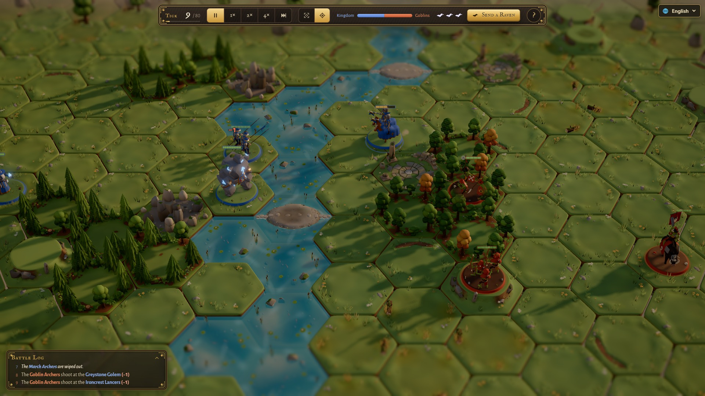

# Runes de Commandement

Wargame fantasy solo sur hexagones. Déployez vos troupes, composez leurs ordres avec des runes, puis adaptez votre stratégie pendant la bataille grâce aux corbeaux messagers. La campagne suit une progression roguelite.

Version 1.1.0 : musique enregistrée en boucle et bruit des effets corrigé.

Code et modèles 3D originaux : MIT. La musique est exclue de MIT et les composants tiers conservent leurs licences, voir [NOTICE.md](NOTICE.md).

## Jouer localement

Depuis ce dossier : `python -m http.server 8765 --bind 127.0.0.1`, puis ouvrir http://127.0.0.1:8765/ dans un navigateur récent avec WebGL. Aucune installation npm ni compilation n’est nécessaire. Les scripts, modèles et polices sont tous locaux. Le son démarre après un geste du joueur. La progression est sauvegardée dans le navigateur lorsque le stockage local est disponible.

## Commandes

- Souris : sélectionner, déployer, programmer les runes et choisir sur la carte
- Caméra : clic gauche glissé pour déplacer, clic droit glissé pour tourner, molette ou bouton central glissé pour zoomer
- Caméra au clavier : flèches ou WASD (ZQSD sur AZERTY) pour déplacer ; R pour recadrer ou alterner vue globale/suivi en bataille
- Bataille : Espace pause/reprise ; 1, 2, 3 pour les vitesses ×1, ×2, ×4
- ? ou F1 : aide ; Échap : fermer ou désélectionner
- Éditeur : Ctrl/Cmd+Z annuler ; Alt+flèches haut/bas déplacer une règle ; Suppr/Retour arrière effacer une condition ciblée
- Tactile : toucher pour sélectionner, un doigt glissé pour déplacer la caméra, deux doigts pour zoomer/tourner

Dans les menus de l’éditeur : Tab pour naviguer, flèches pour parcourir, Entrée ou Espace pour choisir, Début/Fin ou Page précédente/suivante pour atteindre les extrémités ; taper une lettre recherche une option. Sur la poignée d’une règle, les flèches haut/bas la déplacent ; Début/Fin l’envoient au début/à la fin. Pour une valeur numérique : flèches ±1, Page précédente/suivante ±5, Début/Fin minimum/maximum, Entrée pour fermer. Les boutons à l’écran donnent accès aux actions sans raccourci clavier.

## Crédits

Conception, code et modèles Blender réalisés avec Claude (Anthropic) pour Cédric, selon le brief du projet. Adaptation et vérifications LOB7 : Nilo (Codex). three.js 0.170.0 et les polices sont détaillés dans [NOTICE.md](NOTICE.md).
